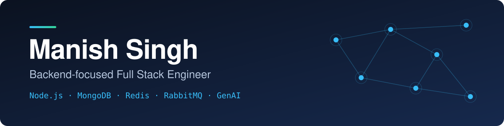
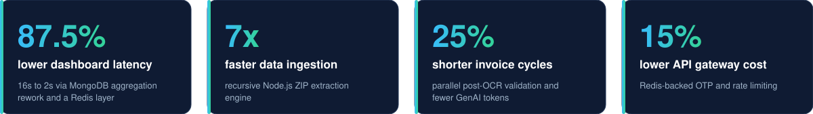
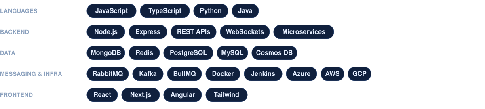
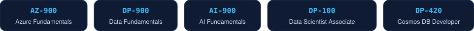

 

&nbsp;&nbsp;

 

## About

Backend-focused engineer with 3+ years of experience building high-throughput Node.js systems, event-driven microservices and data pipelines. I work at **AIQoD**, where I build document-processing and automation services on Node.js, MongoDB, Redis and GenAI.

I care about the parts of a system that decide whether it holds up in production: query performance, queues, rate limits, retries and what happens when something fails.

## Results at work

 

Plus an event-driven notification engine on a decoupled RabbitMQ broker, so compliance alerts no longer depend on the request path.

## Tech

## Featured project

### [HeadcountFilter](https://github.com/Manish814142/HeadcountFilter)

LinkedIn lets you filter jobs by date, level and location, but not by company size. This userscript adds that: it classifies companies anonymously, backs off adaptively when rate-limited, and keeps everything client-side with no backend and no data collection.

`JavaScript` · `Tampermonkey` · `DOM APIs` · 585-case regression suite

## Certifications

 

Open to backend and full-stack roles. The fastest way to reach me is [LinkedIn](https://www.linkedin.com/in/manish814142) or [email](mailto:manish814142@gmail.com).

